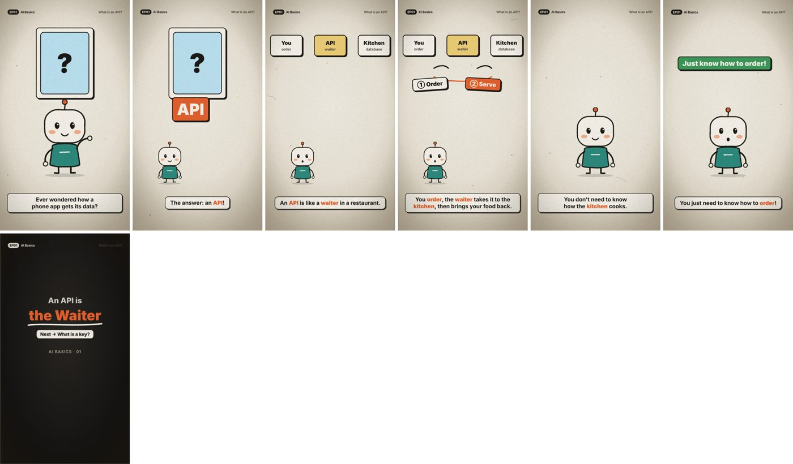
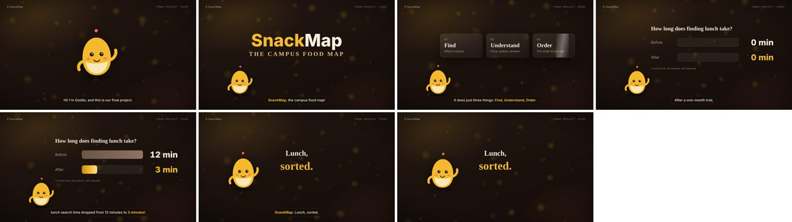

# Motion Video Skill: let an AI agent make motion-design videos for you

**English** | [繁體中文](https://github.com/nutcelvischen-jpg/motion-video-skill/tree/main)

Tell the AI what video you want in one sentence. It writes the narration, builds the animation, records the voice-over and exports an MP4.

- **Two templates**: vertical hand-drawn shorts (teaching, concept explainers) / horizontal premium (project intros, showcases)
- **AI voice-over**: Gemini TTS, with the accent and tone you ask for
- **Subtitles in sync**: every line's subtitle and animation follow the narration timing
- **Endlessly editable**: change a line, a colour or a move, and run it again

| Vertical `shorts` | Horizontal `wide` |
|---|---|
|  |  |

This is an **Agent Skill** (`SKILL.md` format). It works in AI tools that support skills, such as Google Antigravity and Claude Code.

---

## 1. Setup (about 10 minutes)

You need **Python 3.9+**, **Git** and an internet connection.

### 1.1 Open a workspace folder

In Antigravity, open an empty folder (for example `my-video`) and open the Terminal.

### 1.2 Install the skill (English version)

```bash
git clone -b en https://github.com/nutcelvischen-jpg/motion-video-skill .agents/skills/motion-video
```

> To use it in every project, clone it to the global location instead: `~/.gemini/config/skills/motion-video`
>
> For the Traditional Chinese version, leave out `-b en`.

### 1.3 Install packages

macOS:
```bash
pip3 install -r .agents/skills/motion-video/requirements.txt
python3 -m playwright install chromium
python3 .agents/skills/motion-video/scripts/check_env.py
```
Windows:
```powershell
pip install -r .agents/skills/motion-video/requirements.txt
python -m playwright install chromium
python .agents/skills/motion-video/scripts/check_env.py
```
When you see "All set!", you're done.

### 1.4 Set a voice-over API key (can wait until later)

Pick one. **Keep the key in an environment variable only: never in code, never on GitHub, never pasted to the AI.**

- **Google AI Studio** (any Google account): go to https://aistudio.google.com and click Get API key
- **OpenRouter**: create a key at https://openrouter.ai (requires credit)

macOS (set it again in every new terminal):
```bash
export GEMINI_API_KEY="paste your key"
```
Windows PowerShell:
```powershell
$env:GEMINI_API_KEY="paste your key"
```
For OpenRouter, use `OPENROUTER_API_KEY` instead of `GEMINI_API_KEY`.

Test it:
```bash
python .agents/skills/motion-video/scripts/tts.py --probe
```
This writes `probe.wav`. Open it and listen.

---

## 2. Make your first video

Type this in the Antigravity agent chat (then change the topic):

> Use the motion-video skill to make a 45-second vertical explainer about "What is the cloud?" for first-year university students. Explain it with an everyday metaphor, in a friendly British English voice. Show me the storyboard and narration first; build the animation after I approve.

The agent will:
1. Give you a storyboard and narration → **you approve or edit**
2. Create `videos/ep01/` with `script.json` and `index.html`
3. Render a contact sheet `stills/sheet_en.png` and check the frames itself
4. Record the narration (`tts.py`)
5. Export `videos/ep01/out/ep01_en.mp4`

To watch the animation early, open `videos/ep01/index.html?play` in a browser.

### Handy follow-up requests

- "The arrows in scene 2 are too small. Make them bigger and orange."
- "The host overlaps the card. Move the host to the lower right."
- "Change s03's line to '…' and re-record only that scene."
- "Make the pacing snappier: everything should exit 0.2 s later."
- "Now make a Chinese version too."
- "Use our mascot instead." (put the image in `videos/ep01/assets/`)

### Project showcase example

> Use the motion-video skill's wide template to make a 60-second final-project intro. The project is called "…", it solves …, its three features are …, and the results are …. A bright, confident young female voice.

---

## 3. Run the commands yourself

You can also work without the agent. macOS:

```bash
S=.agents/skills/motion-video/scripts
python3 $S/new_episode.py videos/ep01 --template shorts   # create (or --template wide)
python3 $S/render.py videos/ep01 --preview                # refresh preview, open index.html?play
python3 $S/render.py videos/ep01 --sheet                  # contact sheet
python3 $S/tts.py videos/ep01                             # narration
python3 $S/render.py videos/ep01 --lang en                # export MP4
```
Windows PowerShell: change the first line to `$S=".agents/skills/motion-video/scripts"` and use `python` instead of `python3`.

---

## 4. Classroom exercises

1. **Warm-up (15 min)**: use the shorts template without touching the animation. Rewrite the lines in `script.json` to make your own version.
2. **Change the animation (30 min)**: ask the agent to replace the demo's "restaurant" metaphor with one of your own and add a new prop.
3. **Final piece (60 min)**: pick a concept you know well and make a 45–60 second explainer with narration.
4. **Peer review**: check each other's videos with the checklist in `references/design-guide.md`.

---

## 5. How it works

```
script.json (narration) ──► tts.py ──► narration.wav + timeline.json (seconds per line)
                                              │
index.html (visuals + GSAP animation) ◄───────┘ animation timing is tied to the lines
        │
        └──► render.py: Playwright calls __seek(t) every 1/30 s and screenshots ──► ffmpeg ──► MP4
```

The full workflow is in [SKILL.md](SKILL.md); the agent follows it.

---

## License

- Code and docs in this project: MIT License
- `templates/_common/gsap.min.js`: GSAP by GreenSock, used under its [Standard License](https://gsap.com/standard-license)
- Fonts from Google Fonts (Noto Sans TC, Noto Serif TC, Inter, JetBrains Mono), all under the OFL
